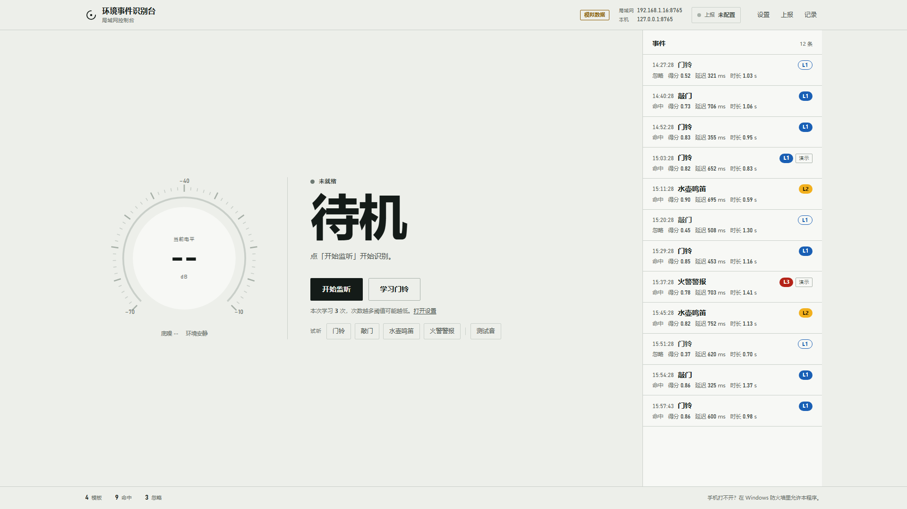
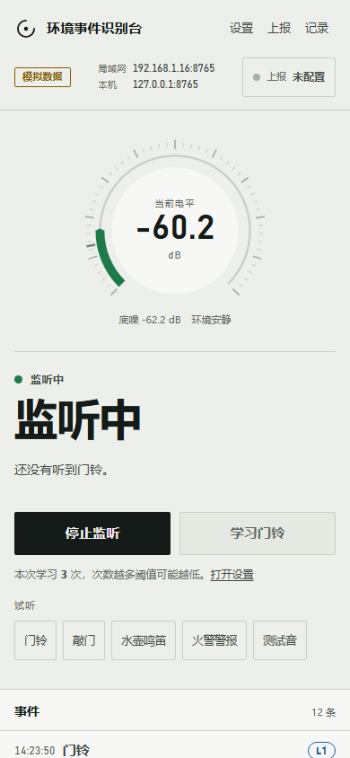

# 前端设计定稿 · 环境事件识别台

**版本** v0.1（2026-11-15）｜ **状态** 设计定稿，已实现预览版 ｜ **关联** `REQ-02-webui.md`（v1.1）、`plan.md` T2 / T3 / T5 / T6 / T7

> 本文只描述视觉与交互方案，不重复需求条文。需求编号（WEB-x、NFR-x、D-x）指向 `docs/REQ-02-webui.md` 与 `docs/decisions.md`。

---

## 1. 范围与已定方向

本轮交付：**静态前端 + 零依赖预览服务（模拟状态）**。真实识别接入（`pc_web.py`、状态总线、`Detector/Recorder`）不在本轮，接口按 `plan.md` 的 API 草案预留。

| 决策 | 结论 |
|---|---|
| 视觉方向 | **监听仪**：浅色仪器面，环即音量条，颜色只承载语义 |
| 交付边界 | `web/static/` 静态页 + `tools/web_preview.py`（stdlib，模拟数据，SSE） |
| 布局 | 单屏分区：顶栏 / 中央仪表 / 右侧事件账本 / 底栏读数 |
| 首屏密度 | 中等：大字、音量、最近事件、命中数、模板数 |
| 投屏模式 | 不做独立路由；普通页面在 1920×1080 下自适应放大 |
| 产品名 | 暂用功能名「环境事件识别台」，顶栏预留可替换标识位 |
| 计量方式 | 环形量表，弧长 = 音量 0–100（−70…−10 dB），另标底噪位置 |
| 命中编排 | 3.5 秒：环变橙收紧、大字换类别、元数据一行；不闪屏、页面不发声 |
| 学习态 | 接管大字区：请按门铃（k/N）+ 15 秒倒计时 + 分段进度 + 取消 |
| 事件详情 | 桌面右侧抽屉 / 手机底部面板 |
| 次级面板 | 三个入口：设置、上报、记录 |
| 断线 | 顶部横幅 + 最后更新时间；不遮罩、不清空数据 |
| Electron | 相对路径、单一 `api.js` 取数入口、`window.__DOORBELL__` 可选、`?mock=1` 可脱离 Python 运行 |

---

## 2. Token

### 2.1 颜色

**原则：饱和色只承载语义，界面结构一律用墨色与发丝线。** 这条原则同时解决了 L1/L2/L3 与状态色互相打架的问题。

| Token | 值 | 用途 |
|---|---|---|
| `--paper` | `#EDEFEA` | 页面底色（冷灰纸，避开 AI 默认的暖奶油底） |
| `--surface` | `#F7F8F5` | 事件栏、抽屉、仪表盘面、输入框 |
| `--ink` | `#141B18` | 正文、大字、主按钮、焦点环 |
| `--ink-2` | `#3F4A45` | 次级文字、按钮文字 |
| `--ink-3` | `#5F6A64` | 标签、时间、读数单位（对纸底 ≥4.8:1） |
| `--rule` | `#C9CFC9` | 发丝线、刻度、轨道 |
| `--rule-strong` | `#A7B0A8` | 强调刻度、面板边界 |
| `--idle` | `#6E7A74` | 未监听状态点 |
| `--listen` | `#1F7A4A` | 监听中状态点与环 |
| `--heard` | `#8A5A00` | 检测到声音（点、环、文案；对纸底 ≥5:1） |
| `--hit` | `#C2410C` | 命中状态环（图形对比 ≥3:1） |
| `--tier-1` | `#1A5FB4` | L1 胶囊（白字） |
| `--tier-2` | `#F2B01E` | L2 胶囊（`#2A1F00` 字） |
| `--tier-3` | `#B42318` | L3 胶囊（白字） |
| `--danger` | `#B42318` | 错误、清空等破坏性动作 |

等级色固定按 WEB-2.7（L1 蓝 / L2 黄 / L3 红）；命中状态环用橙色（WEB-2.8），两者不混用：**环说"现在发生了什么"，胶囊说"这次有多严重"**。

### 2.2 字体

无外网、无构建链（C-2 / C-7），字体只能用系统本地字体。

```css
--font: "Microsoft YaHei UI", "Microsoft YaHei", "PingFang SC",
        "Hiragino Sans GB", "Noto Sans CJK SC", "Source Han Sans SC",
        system-ui, sans-serif;
--font-num: "Bahnschrift", "DIN Alternate", "Segoe UI", "Roboto", var(--font);
```

- 中文全部用系统黑体，靠字重与尺度建立层级，不引入衬线。
- 数字（dB、得分、延迟、时间）用 DIN 系字面（Windows 的 Bahnschrift、iOS 的 DIN Alternate），加 `font-variant-numeric: tabular-nums`，读数不跳动。
- **不用等宽字体做小标签**（这是生成式界面的常见模板特征）；等宽只留给日志本身。

| 层级 | 尺度 | 字重 |
|---|---|---|
| 大字状态 | `clamp(48px, 6.5vw, 104px)`，行高 1.02，字距 −0.015em | 700 |
| 命中读数 | 20px | 600 |
| 正文 / 副文案 | 15–16px | 400 |
| 事件标题 | 15px | 600 |
| 事件元数据 / 标签 | 11–12px | 400–600 |
| 面板标题 | 18px | 700 |
| 分区小标题 | 12px，字距 0.06em | 700 |

### 2.3 间距、圆角、动效

- 间距：4 / 8 / 12 / 16 / 24 / 32 / 48 / 64。
- 圆角：结构面 **0**；控件 **2px**；状态与等级标签 **999px**（胶囊只用于"分类"这一种语义）。
- 动效：读数过渡 120ms linear；抽屉 180ms；事件进入高亮 600ms。`prefers-reduced-motion` 下全部关闭。
- 阴影：仅抽屉/底部面板用 scrim，不用大面积投影；卡片式阴影一律不用。

---

## 3. 布局

### 3.1 桌面（≥1100px，1920×1080 为目标）

```
┌──────────────────────────────────────────────────────────────────────────┐
│ ◔ 环境事件识别台               局域网 192.168.1.23:8765  上报 未配置      │  64
│   局域网控制台                                          设置  上报  记录  │
├──────────────────────────────────────────────────┬───────────────────────┤
│                                                  │ 事件        最近 40 条│
│      ╭──────────────╮                            │ ───────────────────── │
│      │   刻度环      │ │  监听中                  │ 12:04:32 门铃 L1 演示 │
│      │   −38.2 dB    │ │  上一声门铃 12:03:11     │   命中 0.87 412ms 0.82s│
│      ╰──────────────╯ │                          │ 11:58:10 敲门 L1      │
│      底噪 −61.4 dB 安静│ │  [开始监听] [学习门铃]  │   命中 0.71 388ms 0.61s│
│                        │  试听 门铃 敲门 水壶 火警 │ 11:41:03 音乐  —      │
│                        │       测试音             │   忽略 0.42 501ms 1.20s│
├──────────────────────────────────────────────────┴───────────────────────┤
│ 模板 4    命中 12    忽略 3                手机打不开？放行 Windows 防火墙 │  48
└──────────────────────────────────────────────────────────────────────────┘
```

- 页面最大宽 1560px 居中；仪表与读数之间一条竖向发丝线。
- 事件栏 380px，独立滚动；底部「载入更早」按 GET `/api/events` 增量加载。
- 大字随视口放大，1920 下约 104px；不提供单独的投屏页面。

### 3.2 手机（≤720px，390×844 为目标）

```
┌─────────────────────────────┐
│ ◔ 环境事件识别台  设置 上报 记录│
│ 局域网 192.168.1.23:8765 上报│
├─────────────────────────────┤
│        ╭───────────╮         │
│        │  −38.2 dB │         │
│        ╰───────────╯         │
│        底噪 −61.4 dB 环境安静 │
│                              │
│  监听中                      │
│  上一声门铃 12:03:11         │
│  [ 开始监听 ] [ 学习门铃 ]   │
│  试听  门铃 敲门 水壶 火警    │
│        测试音                │
├─────────────────────────────┤
│ 事件                最近 40条│
│ 12:04 门铃 L1               │
│ ...                          │
├─────────────────────────────┤
│ 模板 4  命中 12  忽略 3      │
└─────────────────────────────┘
```

- 窄屏时仪表在上、读数在下；事件栏落到页尾，页面可滚动。
- 抽屉变为底部面板（88dvh，顶部一条 32×2px 抓手）。
- 顶栏两行：品牌 + 三个入口 / 地址 + 上报状态。
- 触控目标 ≥44×44px（NFR-WEB-5）。

---

## 4. 状态编排

| 服务端 mode | 状态点 | 大字 | 副文案 | 动作区 |
|---|---|---|---|---|
| `idle` 无模板 | 灰 | 请先学习门铃 | 点「学习门铃」，按 3 次门铃 | 开始监听禁用 + 原因 |
| `idle` 有模板 | 灰 | 待机 | 点「开始监听」开始识别 | 开始监听 / 学习门铃 |
| `idle` 刚停止 | 灰 | 已停止 | 点「开始监听」重新开始 | 开始监听 |
| `listening` | 绿 | 监听中 | 上一声门铃 12:03:11（无则"还没有听到门铃"） | 停止监听 / 学习门铃 |
| `listening` + heard | 黄 | 监听中 | 听到声音，正在判断… | 同上 |
| `hit`（3.5s） | 橙 | {类别}！ | 隐藏，改由一行读数承担 | 同上 |
| `learning` | 墨色 | 请按门铃 | 第 k 次，共 N 次，还剩 12 秒 | 取消学习 |
| 播放中 | 不变 | 不变 | 正在播放：门铃 | 试听 chip 标记 |

命中读数一行：等级胶囊（颜色+`L1/L2/L3` 文字）→ 得分（两位小数）→ 延迟（毫秒整数）→ 时刻（HH:MM:SS）→ 「演示」空心标记。3.5 秒后回到监听中，副文案转为「上一声门铃 …」。

学习完成后由服务端 `notice` 提供一个 6 秒的短暂态：大字「学习完成 ✓」、副文案「新阈值 0.58」；失败则「没有学到」+ 可读原因（WEB-4.8/4.9）。

断线：顶部墨色横幅「连接已断开，正在重试… · 最后更新 12:03:11」，每 3 秒重连；恢复后横幅消失并重新拉取全量状态与事件。**不遮罩、不清空**，因为最后一次门铃仍有信息价值。

---

## 5. 文案

- 按钮是动作，不是提交：「开始监听」「停止监听」「学习门铃」「取消学习」「保存设置」「测试连接」「导出 CSV」「清空录音」「关闭」。
- 动作名在整条流程里不变：点了「开始监听」，状态就是「监听中」；点了「保存设置」，提示就是「设置已保存」。
- 错误说清是什么、怎么办：「没有可用模板，请先学习门铃」「阈值需在 0.40 到 0.95 之间」「另一台设备正在学习（2/3）」。
- 不出现 `Error 0x…`、不出现英文异常栈（WEB-12.3）。
- 空状态是邀请：「还没有事件。开始监听后，每次判定都会出现在这里。」
- 中文标点；元数据之间用间距和发丝线分隔，不用 `A · B · C` 的中点串。

---

## 6. 无障碍

- 正文与背景对比 ≥4.5:1；大字、仪表刻度是图形元素，≥3:1（NFR-WEB-6）。
- 等级、结论、演示标记都有**文字**，不靠颜色区分（WEB-2.7）。
- 可见焦点：2px 墨色 outline + 2px offset，所有按钮/输入/行可键盘到达。
- 抽屉是 `role="dialog" aria-modal="true"`，有焦点圈定、Esc 关闭、关闭后归还焦点。
- 大字区 `aria-live="polite"`，命中时读屏会播报类别与等级。
- `prefers-reduced-motion` 下关闭读数过渡、抽屉滑动、事件高亮。
- 手机横竖屏都不横向滚动；触控目标 ≥44px。

---

## 7. Electron 预留

1. 所有资源相对引用（`./style.css`、`./app.js`），无 CDN、无外链字体、无构建产物。
2. 取数只有一个入口：`request(path, init)` → 由 `bus` 决定走 SSE/fetch 还是本地模拟；Electron 壳里只需注入 `window.__DOORBELL__ = { apiBase }`，或直接注入自定义 `{ bus }`。
3. `?mock=1` 启动 `mock.js` 的本地状态机，脱离 Python 也能完整走界面；页面顶部标「模拟数据」，不允许把模拟值当真实状态。
4. 不依赖服务端注入的全局变量、不依赖 hash 路由；`file://` 下可直接打开（`?mock=1`）。
5. 安全下一步（Electron 壳内）：`contextIsolation: true`、`nodeIntegration: false`、CSP 白名单化；本轮不引入打包配置。

---

## 8. 设计自检（对照 frontend-design 的模板感清单）

初版方案在动工前被自己否掉了五处：

| 初版 | 问题 | 改为 |
|---|---|---|
| 暖白 `#F4F1EA` + 陶土橙 `#D97757` | AI 默认配色第一名 | 冷灰纸 `#EDEFEA` + 语义橙 `#C2410C`，橙色只出现在"命中" |
| 底栏 `模板 4 · 命中 12 · 忽略 3` | 中点串联的元信息模板 | 三个独立读数块，靠间距分组 |
| 事件行做成圆角卡片 + 统一阴影 | SaaS 卡片套件 | 发丝线账本，无卡片、无阴影 |
| 大字区套一张卡片 | 通用仪表盘 | 仪表与读数直接落在纸面上，一条竖线分栏 |
| 通用进度环 | 换成任何产品都成立 | 加刻度、−70/−10 标尺、底噪标记，成为真正的声学仪表 |

保留的"风险"只有一处：**刻度环**是页面唯一的高光，其余全部安静。学习进度用分段（1/3…3/3）是真实序列，不是装饰编号。全站没有眉标、没有全大写标签、没有渐变、没有 `→`。

---

## 9. 怎么跑

```bat
:: 预览服务（模拟数据，不接麦克风）
python tools\web_preview.py

:: 指定端口 / 只本机 / 不自动开浏览器
python tools\web_preview.py --port 8766 --no-lan
python tools\web_preview.py --open

:: 页面直接打开、不启服务（本地模拟）
web\static\index.html?mock=1

:: 口令演示（可选）
python tools\web_preview.py --password 1234
```

启动后终端会打印本机与局域网地址；手机与电脑连同一 Wi-Fi 打开局域网地址即可。首次可能需要在 Windows 防火墙弹窗中点「允许」（WEB-1.12）。

---

## 10. 本轮实现边界

**已完成**

- `web/static/`：单页 HTML / CSS / JS，无框架、无构建、无外部资源；桌面与手机两套布局。
- 大字区、刻度环、音量与底噪、监听、学习（k/N + 15 秒倒计时 + 取消）、四类试听与测试音、事件账本、事件详情、设置 / 上报 / 记录三个抽屉、口令页、断线横幅、CSV 导出、录音播放与下载。
- `?mock=1` 本地状态机：`file://` 直接打开也能完整走界面，顶栏标「模拟数据」。
- `tools/web_preview.py`：stdlib 预览服务，SSE 8 Hz、事件/日志即时、1 Hz 心跳、端口 8765→8766→8767 退让、默认局域网绑定、可选口令、事件录音合成。
- 已按 Electron 要求收敛：相对路径、单一取数入口、`window.__DOORBELL__` 可注入、无服务端注入变量。

**未完成（下一轮 T1 / 真实接入）**

- `pc_web.py`、`web/state.py`、真实状态总线与 `Detector` / `Recorder` 接线；
- 真实麦克风电平、真实试听播放与抑制窗口；真实 `sounds/events` 录音文件；
- 单实例探测、`run_gui.bat` 切换、`run_gui_classic.bat` 回退、启动三级回退；
- 真实 IoT 链路（当前 IoT 抽屉只验证表单与状态映射）；
- 真实口令校验与存储（当前口令只在预览服务内存中，重启即失效）。

> 预览服务**不是**产品启动器：它用模拟数据证明界面与交互，不替代计划中的 T1。

---

## 11. 客户端依赖的状态与接口

`pc_web.py` 接入时按这份契约实现即可，前端不需要改。

### 11.1 状态字段

| 字段 | 含义 |
|---|---|
| `mode` | `idle` / `listening` / `learning` / `hit` |
| `on_air` | 是否处于监听（命中来自监听时为 true）——用于命中 3.5 秒内按钮不跳变 |
| `stopped` | 刚停止过监听；大字显示「已停止」 |
| `heard` | 检测到声音但未判定（WEB-2.5） |
| `level_db` / `floor_db` / `env` | 电平、底噪、`quiet` / `loud` / `clip` |
| `templates` | `{count, names[], skipped}` |
| `last_hit` / `hit` | 最近一次命中；`hit.until` 为毫秒时间戳 |
| `learn` | `{take, total, remaining, window, attempts}` 或 null |
| `playing` | `{cls, label, test, until}` 或 null |
| `notice` | 6 秒短暂态：`{title, detail, ts, until}`，学习成功/失败用 |
| `iot` / `board` | `{state,last_ok,last_error,sent,dropped,config}`、`{online}` |
| `stats` | `{hit,ignore,demo,avg_latency,max_score,by_class}` |
| `config` | 阈值、门控、设备序号、学习次数、局域网、`password_set` |
| `devices` / `net` | 设备列表；本机与局域网地址、端口 |
| `events_total` / `rec_count` | 事件总数（用于「载入更早」）与录音数 |
| `now` / `mock` | 服务端毫秒时间；是否模拟数据 |

### 11.2 接口

| 方法 | 路径 | 说明 |
|---|---|---|
| GET | `/api/state` | 全量快照，含最近 40 条事件与 ≤300 条日志 |
| GET | `/api/events?before=&limit=` | 更早事件（最多 300 条） |
| GET | `/events` | SSE：`state` 8 Hz、`event`、`log`、`heartbeat` 1 Hz，`retry: 3000` |
| POST | `/api/listen` | `{on:bool}` 幂等 |
| POST | `/api/learn` | `{action:"start"\|"cancel", takes}`；冲突 409 + 中文原因 |
| POST | `/api/preview` | `{cls}` / `{test:true}` / `{file}`；演示命中带 `demo` |
| POST | `/api/settings` | 阈值/门控/设备/学习次数/局域网/口令；`clear_password` |
| POST | `/api/templates/refresh` | 重新扫描模板 |
| POST | `/api/iot/config`、`/api/iot/test` | 上报配置与测试 |
| POST | `/api/recordings/clear` | 清空判定录音（二次确认） |
| POST | `/api/auth` | `{password}` → HttpOnly Cookie；仅开启口令时需要 |
| GET | `/api/export.csv` | UTF-8 BOM、列序固定、`session_YYYYMMDD_HHMMSS.csv` |
| GET | `/api/recordings/{seq}.wav` | 单条判定录音 |

**注意**：SSE 的 `state` 不含 `events` / `logs`（8 Hz 下太重）；首次连接、断线重连、清空录音后，客户端会再拉一次 `/api/state` 补齐。

---

## 12. 截图

### 桌面 1920×1080



### 手机 390×844



> 截图为 `tools/web_preview.py` 的模拟数据；顶栏「模拟数据」标记是刻意保留的诚实标注。
